<div align="center">

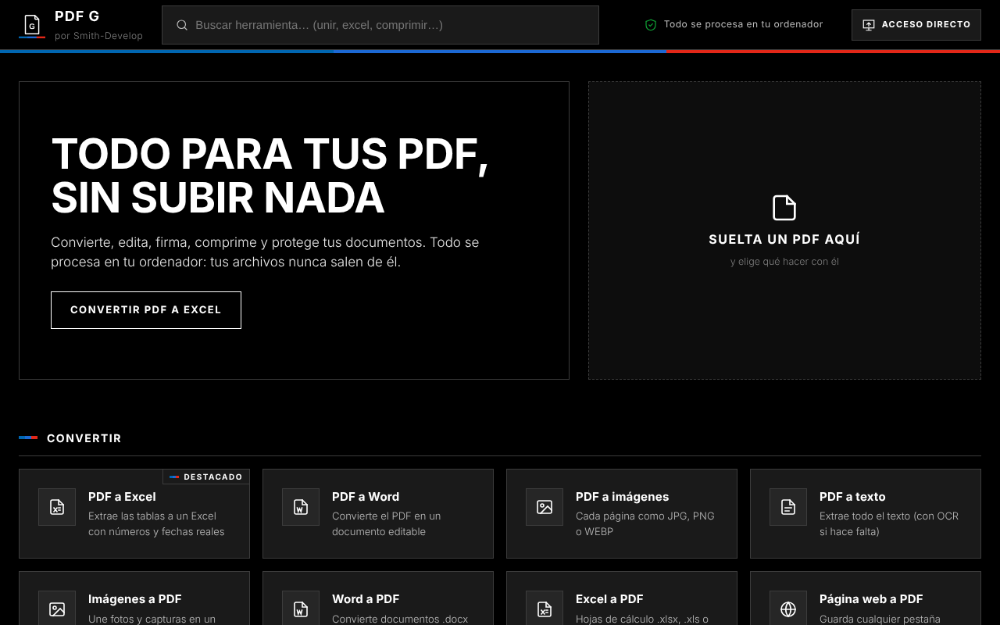

<br/>
<br/>

# 📄 SanPDF — Todo para tus PDF, sin subir nada


</div>

<div align="center">

### Extensión de Chrome con 28 herramientas para PDF. Todo se procesa en tu ordenador: tus archivos nunca salen de él.


<table>
  <tr>
    <td align="right"><b>🚀 Empezar</b></td>
    <td align="center"><a href="#-instalación">📦 Instalación (Windows: 1 doble clic)</a></td>
    <td align="center"><a href="#-en-tres-pasos">👣 En tres pasos</a></td>
    <td align="center"><a href="#%EF%B8%8F-acceso-directo-en-el-escritorio">🖥️ Acceso directo</a></td>
  </tr>
  <tr>
    <td align="right"><b>⭐ Destacado</b></td>
    <td align="center"><a href="#-pdf-a-word-con-el-diseño-original">📝 PDF a Word</a></td>
    <td align="center"><a href="#-ocr-de-escaneado-a-word-editable">🔍 OCR a Word</a></td>
    <td align="center"><a href="#-pdf-a-excel">📊 PDF a Excel</a></td>
  </tr>
  <tr>
    <td align="right"><b>🧰 Todo</b></td>
    <td align="center"><a href="#-las-28-herramientas">🧰 Herramientas</a></td>
    <td align="center"><a href="#-privacidad">🔒 Privacidad</a></td>
    <td align="center"><a href="#-capturas">🎬 Capturas</a></td>
  </tr>
  <tr>
    <td align="right"><b>🛠️ Proyecto</b></td>
    <td align="center"><a href="#-pruebas-automáticas">✅ Pruebas</a></td>
    <td align="center"><a href="#%EF%B8%8F-cómo-está-hecho">🏗️ Arquitectura</a></td>
    <td align="center"><a href="#-limitaciones-conocidas">⚠️ Limitaciones</a></td>
  </tr>
</table>

</div>

---

## 📦 Instalación

### ⚡ Windows: con el instalador

1. Descarga este repositorio (**Code → Download ZIP**) y descomprímelo.
2. Haz doble clic en **`Instalar extensiones.cmd`** y elige **PDF G** en la lista (si Windows avisa: *Más información → Ejecutar de todas formas*).
3. Se abre la página de extensiones con la ruta ya copiada. Haz los **dos clics** que Chrome exige hacer a mano: activa **Modo de desarrollador** y pulsa **Cargar descomprimida** → `Ctrl+V` en la barra de dirección → **Seleccionar carpeta**.
4. El instalador lo detecta solo, **crea el acceso directo "PDF G" en el escritorio** y abre la aplicación.


- Funciona con **Chrome, Edge y Brave** (si tienes varios, te pregunta en cuál).
- La extensión se copia a `%LOCALAPPDATA%\Extensiones\PDF G`, así que puedes borrar la carpeta descargada.
- **Para eliminarla**, ejecuta el instalador y elige *Eliminar una extensión instalada*: abre la página de extensiones para que pulses *Quitar* y después borra su carpeta y su acceso directo.
- **Para actualizar**, sustituye la carpeta por la versión nueva y vuelve a ejecutar el instalador: reemplaza los archivos sin repetir los clics.
- Como el instalador crea el acceso directo, PDF G ya no muestra su aviso de bienvenida al instalarse así.

#### Instalar otras extensiones con el mismo archivo

`Instalar extensiones.cmd` sirve para cualquier extensión: lista todas las carpetas que tengan un `manifest.json` junto a él y te deja elegir.

```
Mis extensiones/
├── Instalar extensiones.cmd
├── pdf-g/            → "PDF G  v1.3.2"
└── incidencias-g/    → "Incidencias G  v0.4.2"
```

Para añadir otra, copia su carpeta al lado: no hay que editar el `.cmd`. Del `manifest.json` toma el nombre (también si está traducido con `__MSG_…__`), la versión y el icono del acceso directo. El acceso directo abre `app.html`, `index.html`, la ventana emergente o la página de opciones, la primera que exista. Cada extensión se copia a `%LOCALAPPDATA%\Extensiones\<nombre>`.

> **¿Por qué no es 100 % automático?** Chrome no deja que ningún programa active el modo de desarrollador ni cargue extensiones por su cuenta (desde Chrome 137 ignora incluso la opción `--load-extension`). Saltarse esa protección exigiría manipular archivos protegidos del perfil, que es lo que hace el malware. La instalación en un clic real llegará publicando PDF G en la Chrome Web Store.

### 🛠️ Manual (cualquier sistema)

1. Descomprime el ZIP en una carpeta que no vayas a borrar.
2. Abre `chrome://extensions` y activa el **Modo de desarrollador**.
3. Pulsa **Cargar descomprimida** y elige la carpeta **`pdf-g`**.
4. Fija el icono en la barra de Chrome: al pulsarlo se abre PDF G.

## 👣 En tres pasos


Cada resultado tiene **Ver** y **Descargar**, y los PDF se pueden encadenar con **Seguir trabajando con este PDF…** (por ejemplo: unir → numerar → comprimir) sin volver a subir nada.

---

## 📝 PDF a Word con el diseño original


Como cuando abres un PDF con Word: cada página del documento tiene **el mismo tamaño que el PDF**, con el **fondo** (imágenes, colores y formas) detrás y el **texto editable** encima, en marcos colocados en su sitio, con su fuente, tamaño, negrita y color. Se conservan los saltos de línea, la alineación y las columnas.

| Modo | Qué obtienes |
| --- | --- |
| **Diseño original** *(por defecto)* | Mismo aspecto que el PDF, con el texto editable. |
| **Solo texto** | Documento fluido con títulos, párrafos y tablas reconstruidas. |
| **Idéntico** | Cada página como imagen (no editable). |
| **Ambos** | Imagen + texto fluido. |

## 🔍 OCR: de escaneado a Word editable


Para PDF escaneados o hechos con imágenes (carteles, infografías, fotos de documentos):

1. **Reconoce** el texto con Tesseract (español e inglés incluidos, sin conexión), en varias pasadas para leer tanto la letra pequeña como los títulos grandes.
2. **Lo borra de la imagen**, rellenando cada palabra con el color de fondo que la rodea.
3. **Lo coloca encima, editable**, con su color, tamaño, negrita y el mismo ancho que en la imagen.

Los iconos, fotos y la letra manuscrita se quedan como imagen. También puede generar un **PDF buscable** (mismo aspecto, con una capa de texto invisible para buscar y copiar).

<div align="center">
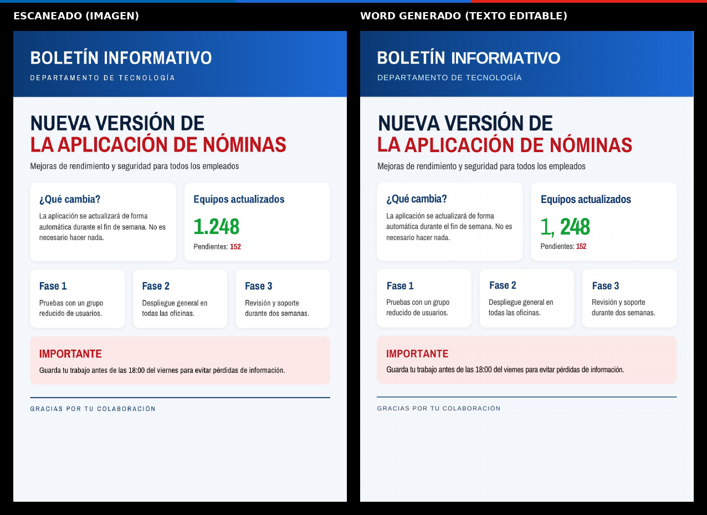
<br/><sub>Boletín de ejemplo (<code>tests/boletin.html</code>) convertido con la herramienta OCR. A la derecha, el Word abierto con LibreOffice.</sub>
</div>

## 📊 PDF a Excel


- Tablas **con bordes** (facturas) y **sin bordes** (extractos bancarios, listados).
- Números en formato español o inglés, importes con €, negativos, % y fechas se guardan como **valores reales de Excel**: se pueden sumar y filtrar.
- Une los conceptos partidos en dos líneas y escribe una sola vez la cabecera que se repite en cada página.
- **Vista previa editable** antes de descargar. Salida en una hoja, una por página o una por tabla, o CSV.

---

## 🧰 Las 28 herramientas


<details>
<summary><b>Ver la lista con lo que hace cada una</b></summary>

| Categoría | Herramienta | Qué hace |
| --- | --- | --- |
| Convertir | PDF a Excel | Tablas a Excel con números y fechas reales (OCR si es escaneado). |
| | PDF a Word | Diseño original editable, texto fluido o imagen. |
| | PDF a imágenes | JPG, PNG o WEBP a 72–300 ppp. |
| | PDF a texto | Todo el texto, con columnas separadas por tabuladores (OCR si hace falta). |
| | Imágenes a PDF | Une fotos y capturas; tamaño de página, orientación y margen. |
| | Word a PDF | `.docx` a PDF con el motor de impresión de Chrome. |
| | Excel a PDF | `.xlsx`, `.xls` (XML de Excel 2003 y tablas HTML) y CSV; ajusta las columnas al ancho de la página. |
| | Página web a PDF | Cualquier pestaña abierta, con texto seleccionable. |
| Organizar | Unir PDF | Varios PDF (e imágenes) en uno, en el orden que quieras. |
| | Dividir PDF | Cada página, cada N páginas o por rangos. |
| | Organizar páginas | Reordena, gira, duplica, borra, inserta en blanco o añade otro PDF. |
| | Extraer páginas | Las que elijas, juntas o una por archivo. |
| | Girar PDF | Las seleccionadas o todas. |
| | Eliminar páginas | Quita las que sobran. |
| Editar y firmar | Editar PDF | Texto, imágenes, dibujo, resaltar, tapar y tachar. |
| | Firmar PDF | Dibuja o escribe tu firma; se guardan las últimas. |
| | Rellenar formulario | Campos de texto, casillas y listas; opción de aplanar. |
| | Marca de agua | Texto o imagen, en diagonal, centrada, en mosaico o en una esquina. |
| | Numerar páginas | "Página 1 de 10" con formato y posición a elegir. |
| | Datos del documento | Título, autor, asunto y palabras clave. |
| Optimizar y proteger | Comprimir PDF | 4 niveles: sin pérdida, recomendada, fuerte y máxima. |
| | OCR: escaneado a Word o PDF | Word editable con el diseño original o PDF buscable. |
| | Proteger con contraseña | Cifrado AES de 256 bits y permisos. |
| | Quitar contraseña | Si conoces la contraseña. |
| | Aplanar PDF | Fija formularios y anotaciones (o cada página como imagen). |
| | Reparar PDF | Reconstruye la estructura interna. |
| Crear | Crear PDF | Documento nuevo en blanco con el editor. |
| | Texto a PDF | Pega un texto o carga un `.txt`. |

</details>

## 🔒 Privacidad


- Todas las librerías van **dentro de la extensión** (sin CDN, sin servidor, sin telemetría).
- Permisos: `storage` (firmas guardadas) y `downloads` (guardar en *Descargas/PDF G*). "Página web a PDF" pide `debugger` y acceso a las webs **solo cuando la usas**.

## 🖥️ Acceso directo en el escritorio


Chrome no permite que una extensión escriba en el escritorio, así que el botón **Acceso directo** (y el aviso que aparece al instalarla) descarga un pequeño instalador:

- **Windows:** `Crear acceso directo PDF G.cmd` → doble clic → aparece **PDF G** en el escritorio con su icono, y abre la aplicación en su propia ventana. Si Windows avisa, *Más información → Ejecutar de todas formas*.
- **Linux:** `PDF G.desktop` → muévelo al escritorio y marca *Permitir ejecutar*.
- **macOS:** no se puede crear automáticamente; usa un marcador o fija la pestaña.

---

## 🎬 Capturas

| | |
| :---: | :---: |
| 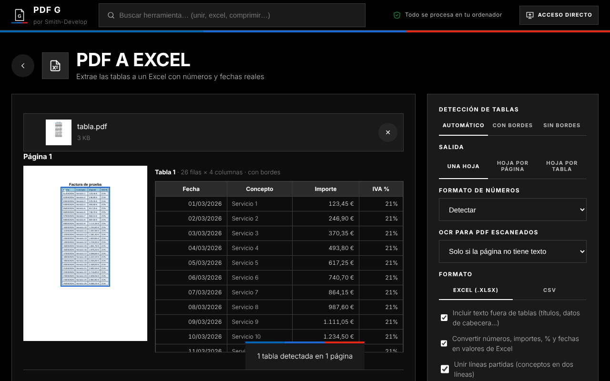 | 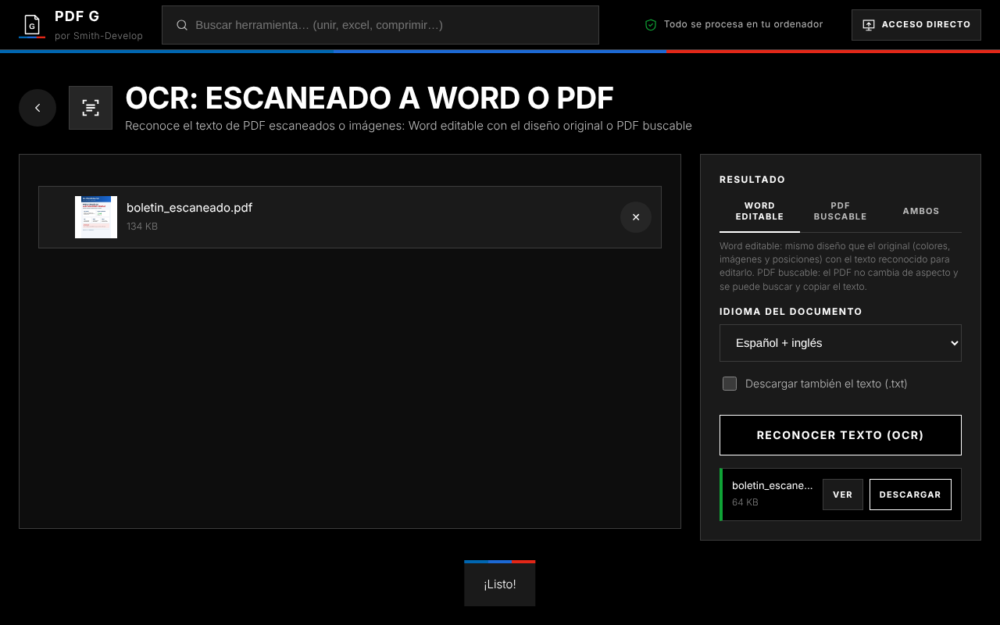 |
| **PDF a Excel** · vista previa editable | **OCR** · escaneado a Word editable |
| 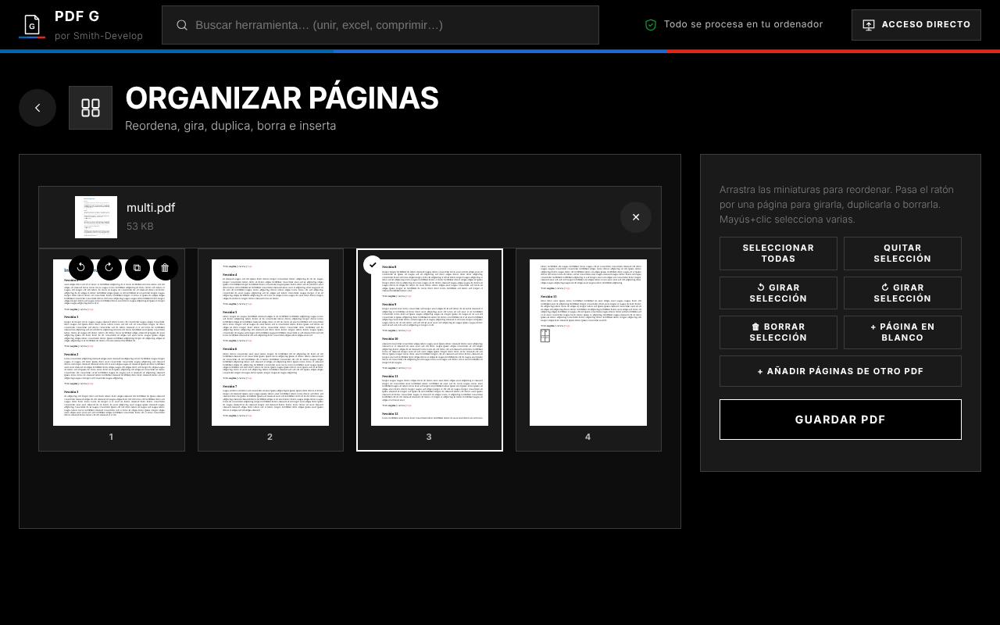 | 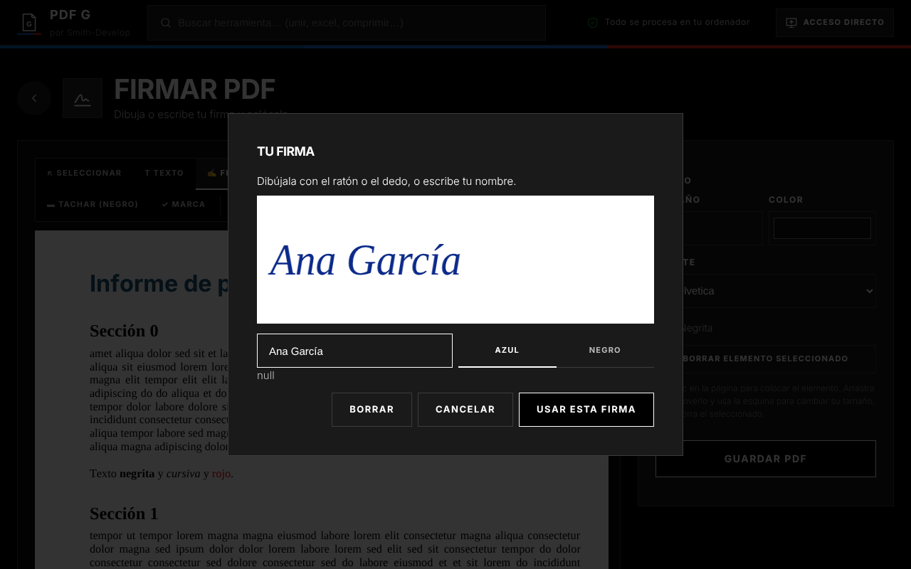 |
| **Organizar páginas** · arrastra, gira, duplica | **Firmar PDF** · dibujada o escrita |

## ✅ Pruebas automáticas

Las pruebas cargan **la extensión real** en Chromium y usan cada herramienta como lo haría una persona (subir archivos, pulsar, escribir, arrastrar, firmar). Después se comprueba el contenido de cada archivo generado (páginas, texto, giros, campos, cifrado, celdas de Excel…).

```bash
cd tests
npm install              # instala Playwright
python3 fixtures.py      # crea los documentos de prueba (reportlab, Pillow, poppler, LibreOffice)
node run.mjs             # 32 casos; resultados en tests/out
python3 check.py         # valida el contenido de cada resultado
```

Puedes probar solo algunas: `node run.mjs pdf2word,ocr_demo,excel2pdf`.

## 🏗️ Cómo está hecho

| Pieza | Para qué |
| --- | --- |
| [pdf.js](https://mozilla.github.io/pdf.js/) | Leer y dibujar PDF, extraer texto. |
| [pdf-lib](https://pdf-lib.js.org/) | Crear y modificar PDF (unir, firmar, formularios, marcas…). |
| [docx](https://docx.js.org/) | Generar los Word. |
| [ExcelJS](https://github.com/exceljs/exceljs) | Leer y escribir Excel. |
| [mammoth](https://github.com/mwilliamson/mammoth.js) | Word a HTML para imprimir. |
| [Tesseract.js](https://tesseract.projectnaptha.com/) | OCR en el navegador (WebAssembly). |
| [qpdf](https://qpdf.sourceforge.io/) (WASM) | Cifrar, descifrar, reparar y optimizar. |

Más detalle en **[docs/ARQUITECTURA.md](docs/ARQUITECTURA.md)**. Las licencias de cada librería están en [`pdf-g/lib/LICENCIAS.txt`](pdf-g/lib/LICENCIAS.txt).

## ⚠️ Limitaciones conocidas

- **PDF a Word / OCR a Word:** las imágenes forman parte del fondo de la página (no se mueven por separado). Se conservan los saltos de línea del original, así que si escribes mucho texto nuevo no se reparte solo entre líneas.
- **OCR:** depende de la calidad de la imagen. La letra manuscrita, los textos muy decorados y algunos títulos muy grandes se quedan como imagen. Para letra condensada se usa *Arial Narrow* si está instalada (viene con Office); si no, Arial con el espaciado ajustado.
- **Excel a PDF:** el `.xls` binario antiguo no se puede leer; guárdalo como `.xlsx`.
- **Word / Excel a PDF:** se abren en la vista de impresión de Chrome (elige *Guardar como PDF*); maquetaciones muy complejas pueden variar.

---

<div align="center">
<sub>Hecho por <a href="https://github.com/Smith-Develop">Smith-Develop</a> · La extensión se llama <b>PDF G</b></sub>
</div>
